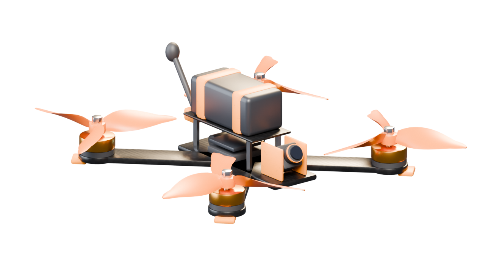

# FPV-Drohne: Assets und Unreal-Import



Alle Assets werden prozedural per Skript erzeugt. Die fertigen Dateien liegen bereits unter `Assets/Export/`, neu bauen ist nur nach Änderungen an den Skripten nötig.

## Neu erzeugen

```bash
pip install bpy numpy pillow     # bpy = Blender als Python-Modul (Python 3.11/3.13)
./Assets/build_all.sh            # alles inkl. Icon-Renderings (ca. 1-2 Minuten, CPU)
./Assets/build_all.sh --no-render  # nur Meshes/Texturen/UI/Audio, ohne Icons neu zu rendern
```

Ohne `bpy` wird automatisch ein installiertes `blender` im Hintergrundmodus benutzt. Die Quell-Szene zum Weiterbearbeiten liegt in `Assets/Source/Blender/FPVDrone.blend`, wird aber bei jedem Lauf überschrieben. Dauerhafte Änderungen gehören deshalb in `build_fpv_assets.py`.

## Ordnerstruktur

| Ordner | Inhalt |
|---|---|
| `Assets/Source/Blender/` | `build_fpv_assets.py` (Modelle, Export, Icon-Render), `FPVDrone.blend` |
| `Assets/Source/Scripts/` | `gen_textures.py`, `gen_ui.py` (Icons + OSD), `gen_audio.py` |
| `Assets/Export/Meshes/` | FBX-Dateien |
| `Assets/Export/Textures/` | Material-Texturen (PNG) |
| `Assets/Export/Icons/` | Item-Icons 512/256/64 |
| `Assets/Export/UI/OSD/` | HUD/OSD-Grafiken, Vollbild-Overlays |
| `Assets/Export/UI/Fonts/` | OSD-Schrift (DejaVu Sans Mono Bold, freie Lizenz) |
| `Assets/Export/Audio/` | WAV-Sounds |

## Zielpfade im Unreal-Projekt (Mod-Referenz `FPVDrone`)

| Asset | Pfad in Unreal |
|---|---|
| Meshes | `/FPVDrone/Drone/Mesh/` |
| Materialien und Texturen | `/FPVDrone/Drone/Materials/`, `/FPVDrone/Drone/Textures/` |
| Icons | `/FPVDrone/Drone/Icons/` |
| OSD | `/FPVDrone/UI/OSD/`, Schrift unter `/FPVDrone/UI/Fonts/` |
| Sounds | `/FPVDrone/Audio/` (Sound Waves heißen `SW_*`, Dateien behalten den Namen) |

## Meshes

Maßstab: 1 Blender-Meter = 100 UU, vorne = +X, oben = +Z. Der Rahmen ist ein 5-Zoll-Quad mit 225 mm Motorabstand diagonal.

| Mesh | Tris | Pivot | Sockets (Name in Unreal) |
|---|---|---|---|
| `SM_FPVDrone_Frame` | 6.9k | Schwerpunkt (inkl. Akku) | `Socket_Prop_FL`, `Socket_Prop_FR`, `Socket_Prop_RL`, `Socket_Prop_RR`, `Socket_FPVCam`, `Socket_Antenna`, `Socket_LED`, `Socket_Battery`, `Socket_Bottom` |
| `SM_FPVDrone_Prop_CCW` | 2.2k | Nabe unten | keine |
| `SM_FPVDrone_Prop_CW` | 2.2k | Nabe unten | keine |
| `SM_FPVDrone_PropBlur` | 46 | Nabe | keine, Scheibe mit Unschärfe-Textur |
| `SM_FPVDrone_Camera` | 0.6k | Neigeachse | `Socket_Lens` |
| `SM_FPV_Remote` | 2.8k | Mitte | `Socket_Grip_L`, `Socket_Grip_R`, `Socket_Screen` |
| `SM_FPV_Goggles` | 1.5k | Mitte Gehäuse | `Socket_Head` |

Hinweise für den Code:

- Propeller-Zuordnung: FL und RR = CCW, FR und RL = CW (Props-in). Für Props-out die Meshes tauschen.
- Drehrichtung in Unreal: Yaw positiv dreht von oben gesehen im Uhrzeigersinn. CW-Props drehen also mit positivem, CCW-Props mit negativem Yaw.
- Ab etwa 30 % Drehzahl die Prop-Meshes ausblenden und `SM_FPVDrone_PropBlur` einblenden (Opacity über die Drehzahl steuern).
- Die Kamera ist ein eigenes Mesh. Am `Socket_FPVCam` anhängen und um Pitch = Uptilt drehen (Default 30 Grad), die Spielerkamera an `Socket_Lens` der Kamera oder direkt am Socket mit gleichem Pitch.
- Kollision: drei konvexe Hüllen (`UCX_SM_FPVDrone_Frame_00..02`) für Mittelteil und beide Diagonalen. Props haben keine Kollision.

## Import-Schritte

1. FBX aus `Assets/Export/Meshes/` per Drag and Drop in `/FPVDrone/Drone/Mesh/` ziehen.
2. Im Import-Dialog:
   - `Skeletal Mesh` aus, `Generate Missing Collision` aus (eigene UCX-Hüllen sind dabei)
   - `Import Normals`: **Import Normals**, `Combine Meshes` an
   - `Material Import Method`: **Do Not Create Material** (Materialien unten von Hand anlegen) oder **Create New Materials** und danach ersetzen
   - `Transform`: alles auf Default lassen, **nicht** `Force Front XAxis` setzen
3. Sockets prüfen: Static Mesh Editor, Fenster `Socket Manager`, die Namen müssen wie oben lauten.
4. Lightmap-UVs generiert Unreal automatisch (`Generate Lightmap UVs` an).

## Materialien

Ein Master-Material `M_FPV_Master` (Default Lit) mit Parametern `BaseColorTex`, `NormalTex`, `ORMTex`, `Tint`, `UVScale` und daraus Material Instances anlegen. Die UVs sind Box-projiziert in Weltgröße, bei `UVScale` = 1 kachelt die Textur alle 5 cm.

| Material-Slot | Instanz von | Texturen und Werte |
|---|---|---|
| `M_FPV_Carbon` | Master | `T_FPV_Carbon_BC`, `T_FPV_Carbon_N`, `T_FPV_Carbon_ORM` |
| `M_FPV_Paint` | Master | `T_FPV_Paint_BC`, `T_FPV_Paint_N`, `T_FPV_Paint_ORM` (FICSIT-Orange, Tint für Spielerfarben nutzbar) |
| `M_FPV_MotorBell` | Master | `T_FPV_Brushed_BC`, `T_FPV_Brushed_ORM`, Tint Orange (0.95, 0.42, 0.08), Metallic aus ORM.B |
| `M_FPV_Steel` | Master | ohne Textur, Farbe (0.62, 0.62, 0.64), Metallic 1, Roughness 0.25 |
| `M_FPV_Plastic` | Master | Farbe fast schwarz, Roughness 0.55 |
| `M_FPV_Battery` | Master | Farbe (0.018, 0.02, 0.025), Roughness 0.4 |
| `M_FPV_Foam` | Master | Farbe (0.03, 0.03, 0.03), Roughness 0.95 |
| `M_FPV_Prop` | Master | Farbe (0.75, 0.16, 0.01), Roughness 0.35 (optional Subsurface/Translucent) |
| `M_FPV_Lens` | Master | Farbe fast schwarz, Roughness 0.03 |
| `M_FPV_LED` | eigenes Material | Unlit/Emissive, Parameter `LEDColor`, `Intensity`; optional `T_FPV_LEDMask` für Segmente |
| `M_FPV_Screen` | eigenes Material | Emissive, Parameter `ScreenColor` |
| `M_FPV_PropBlur` | eigenes Material | Translucent, Unlit, `T_FPV_PropBlur` (Alpha), Parameter `Opacity`, Panner/Rotator für leichtes Flackern |

Textur-Einstellungen:

- `*_BC`: sRGB an, Compression Default
- `*_N`: Compression **Normalmap**. Die Normal Maps sind bereits im DirectX-Format (Unreal-Standard), also **kein** `Flip Green Channel`
- `*_ORM`: sRGB **aus**, Compression **Masks**
- `T_FPV_PropBlur`: sRGB an, Compression Default (mit Alpha)

## Icons

| Datei | Verwendung |
|---|---|
| `IconFPVDrone_256` / `_64` | `Desc_FPVDrone`: `mPersistentBigIcon` (256) und `mSmallIcon` (64) |
| `IconFPVRemote_256` / `_64` | Fernsteuerung als Ausrüstung (optional) |
| `IconFPVGoggles_256` / `_64` | FPV-Brille als Kopf-Ausrüstung (optional) |
| `IconFPVProp_256` / `_64` | Ersatzpropeller als Bauteil/Verbrauchsgut (optional) |

Import mit Texture Group **UI**, Compression **UserInterface2D (RGBA)**, Mip Gen **NoMipmaps**. Die `_512`-Varianten sind nur Quelldateien.

## OSD/HUD

Alle OSD-Elemente sind weiß mit schwarzer Kontur, damit sie in UMG per `Color and Opacity` eingefärbt werden können. Import wie Icons (UI, UserInterface2D, keine Mips).

| Datei | Zweck |
|---|---|
| `T_OSD_Crosshair` | Fadenkreuz in Bildmitte |
| `T_OSD_Horizon`, `T_OSD_HorizonSidebar` | künstlicher Horizont: Linie per Roll drehen und per Pitch verschieben, Seitenleisten statisch |
| `T_OSD_Battery_Frame`, `T_OSD_Battery_Fill` | Akkuanzeige, Fill als Progress Bar (Farbe grün/gelb/rot per Code) |
| `T_OSD_RSSI`, `T_OSD_LinkQuality` | Signalstärke und Link-Qualität |
| `T_OSD_Warning`, `T_OSD_HomeArrow` | Warnsymbol, Pfeil zum Startpunkt (Rotation per Code) |
| `T_OSD_Mode_Acro`, `_Angle`, `_Horizon`, `_3D`, `_AirMode`, `_Turtle`, `_Rescue` | Flugmodus-Badges |
| `T_OSD_Status_Armed`, `_Disarmed`, `_Failsafe`, `_LowBattery`, `_NoSignal`, `_Throttle` | Status-Badges (Failsafe, LowBattery, NoSignal gefüllt für mehr Aufmerksamkeit) |
| `T_OSD_StickBox`, `T_OSD_StickDot` | Stick-Anzeige für Kalibrierung und optionales Overlay |
| `T_OSD_FontAtlas` | 16x6-Zeichenatlas (ASCII 32..126, letztes Feld = Gradzeichen) für klassischen MAX7456-Look |
| `T_OSD_GogglesVignette` | 1920x1080 Vignette der Brille |
| `T_OSD_StaticNoise` | 2x2-Flipbook mit analogem Bildrauschen, Opacity an schlechtes Signal koppeln |
| `T_OSD_Scanlines` | kachelnde Scanlines (Tiling an, Filter Nearest) |
| `Fonts/DejaVuSansMono-Bold.ttf` | als Font Asset importieren, für Zahlenwerte (Spannung, Zeit, Höhe, Speed) |

Empfehlung für den Post-Process: Material `M_FPV_GogglesPP` (Post Process Domain) mit Vignette, leichter chromatischer Aberration, `T_OSD_StaticNoise` und Scanlines, Stärke über einen Parameter `SignalLoss` (0..1).

## Sounds

44.1 kHz, 16 Bit, mono. Für alle Sound Waves `Attenuation` mit 3D-Spatialization nutzen (außer Beeps im OSD).

| Datei | Loop | Kopplung im Code |
|---|---|---|
| `SW_Motor_Loop` | ja | Pitch 0.5 bis 2.0 über gemittelte Motordrehzahl, Volume über Drehzahl |
| `SW_PropWash_Loop` | ja | Volume über Schub, leichte Pitch-Variation bei schnellen Lastwechseln |
| `SW_ESC_Startup` | nein | beim Einstecken des Akkus bzw. Spawnen der Drohne |
| `SW_Arm`, `SW_Disarm` | nein | Arm/Disarm |
| `SW_ModeSwitch` | nein | Flugmoduswechsel |
| `SW_Beep_Warn` | nein | Low Battery, Failsafe |
| `SW_Beep_Lost_Loop` | ja | Beeper-Schalter / Drohne suchen nach Absturz |
| `SW_Crash` | nein | harter Aufprall |
| `SW_PropStrike` | nein | leichte Propeller-Berührung |
| `SW_VideoStatic_Loop` | ja | Rauschen in der Brille, Volume = `SignalLoss` |
| `SW_TurtleFlip` | nein | Turtle-Mode (Flip after Crash) |

`Looping` im Sound Wave für alle `*_Loop`-Dateien anhaken. Die Loops sind nahtlos erzeugt.

## Animationen

Die Drohne braucht keine Skelett-Animationen. Bewegung entsteht im Code:

- Propeller: lokale Z-Rotation pro Tick, Prop-Blur-Überblendung abhängig von der Drehzahl
- Kamera: Pitch = Uptilt am `Socket_FPVCam`
- LED: Farbe/Blinken über dynamische Material-Instanz (`LEDColor`, `Intensity`), z. B. Blinken bei Disarm und Failsafe
- Fernsteuerungs-Sticks: optional; die Sticks sind Teil des Meshes. Für sichtbar bewegte Sticks könnten sie später als eigene Meshes herausgelöst werden

## Lizenz

Alle Modelle, Texturen, Grafiken und Sounds sind für dieses Projekt prozedural erzeugt. Die OSD-Schrift ist DejaVu Sans Mono (Bitstream-Vera-Lizenz, siehe `Export/UI/Fonts/DejaVu-LICENSE.txt`).
